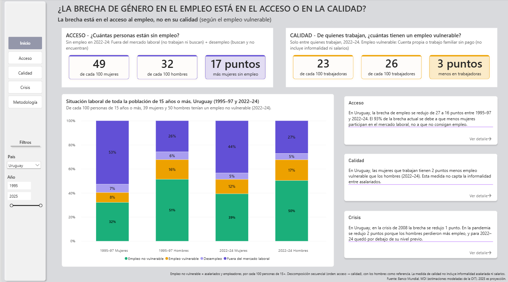

# Gender Gap in Employment: Argentina, Brazil, Chile, Colombia and Uruguay

End-to-end data project: a Python pipeline pulls labor-market indicators from the World Bank API, validates them against national statistics, computes gap metrics and decompositions, and a Power BI dashboard shows the gender gap in employment from 1995 to 2025.

> **Status:** the data pipeline and validation are complete; the Power BI dashboard is being finalized.



## Question

Is the gender gap in employment concentrated in **access** to the labor market or in the **quality** of employment, and how did it change with the 2008 crisis and the 2020 pandemic?

## Approach

```
World Bank API -> data/raw -> validation -> gaps + decompositions -> data/processed (star schema) -> Power BI
```

- **Python** (`pandas`, `wbgapi`): extraction, validation, cleaning, gap metrics and decompositions.
- **Power BI** (DAX): data model, period averages and the dashboard.
- **Validation:** internal consistency checks and a cross-check of the World Bank values against the national statistics offices (INDEC, IBGE, INE Chile, DANE, INE Uruguay). The gaps match with a mean error below 1 pp.

## Key findings (preliminary)

- **The employment gap narrowed in all five countries** between 1995–97 and 2022–24, from −4.5 pp in Colombia to −20.3 pp in Chile, but it is still 16–25 pp.
- **The gap is in access, not in quality** (measured as vulnerable employment): access explains 100–134% of the gap in non-vulnerable employment in four of the five countries; Chile is close to neutral.
- Employed women are *less* often in vulnerable employment than men, mainly because men are more often own-account workers.

## Data

World Bank, World Development Indicators (ILO modeled estimates), license CC BY 4.0. Countries: ARG, BRA, CHL, COL, URY. Period: 1995–2025 (2025 is an ILO projection and is flagged as provisional).

## Repository structure

```
├── data/
│   ├── raw/          API snapshot and indicator metadata
│   ├── validation/   national values (with sources) and comparison
│   └── processed/    fact and dimension tables for Power BI
├── docs/
│   ├── methodology.md   indicators, framework, validation, limitations, decisions
│   └── formulas.md      formulas and chart specs (Spanish)
├── powerbi/          dashboard (.pbix), DAX measures and theme
├── reports/figures/  charts
└── src/              pipeline scripts (01 → 05) and config
```

## How to run

```powershell
python -m venv .venv
.\.venv\Scripts\Activate.ps1
pip install -r requirements.txt

python src\01_validate_api.py
python src\02_extract_metadata.py
python src\03_compare_national.py
python src\04_build_tables.py
python src\05_explore_vulnerable.py
```

Then open `powerbi/gender_gap_dashboard.pbix`.

---

> 🇪🇸 **Resumen:** Proyecto de datos de punta a punta sobre la brecha de género en el empleo en Argentina, Brasil, Chile, Colombia y Uruguay (1995–2025). Un pipeline en Python extrae los indicadores del Banco Mundial, los valida contra las estadísticas oficiales de cada país, calcula las brechas y sus descomposiciones, y alimenta un dashboard en Power BI (en etapa final). Hallazgo principal: la brecha se redujo en los cinco países y se explica por el **acceso** al mercado laboral (participación y desempleo), no por la calidad del empleo medida como empleo vulnerable. Detalle metodológico en [docs/methodology.md](docs/methodology.md).

## Author

**Gina Riveros**: [GitHub](https://github.com/GPaolaR)
